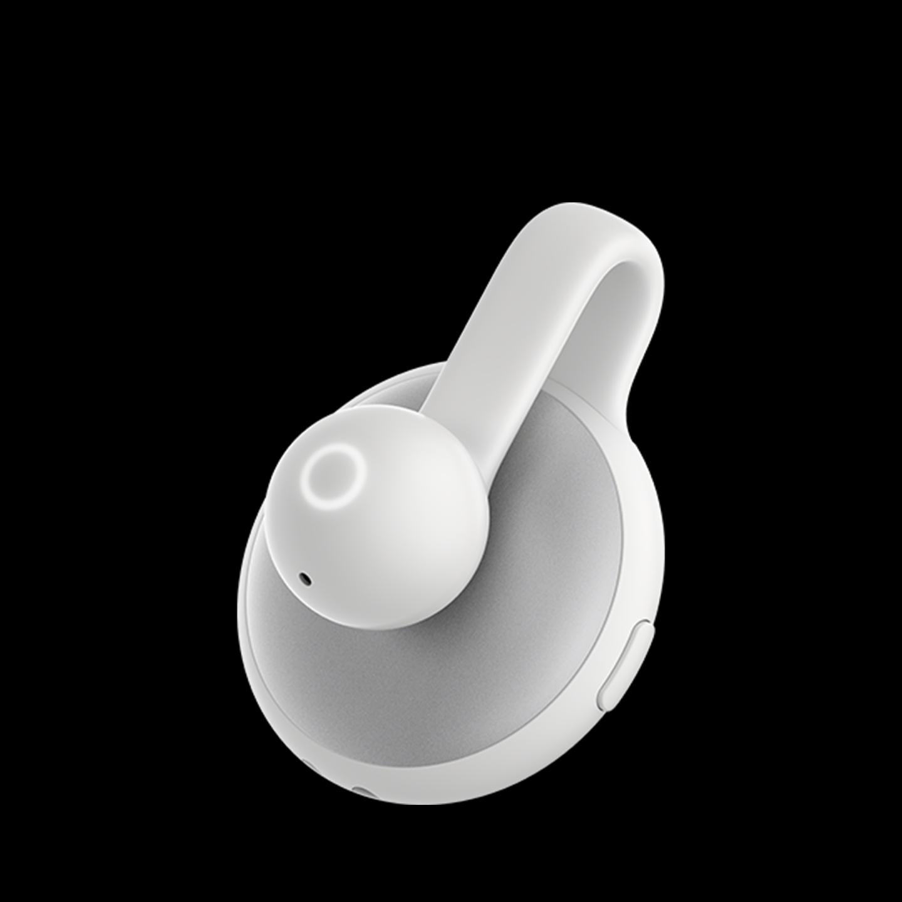

<h1 align="center"></h1>

<p align="center"><strong>Course Companion</strong><br>面向大学生的 Codex 课程助手：维护资料、回顾课堂、追踪考试与作业要求。</p>

<p align="center"></p>

<p align="center">Python 3.10+ · Local MCP + Skills · MIT（代码） · 非 OPPO 官方插件</p>

<h2></h2>

把 OPPO AI Pin 的全时记、随口记与本地教材、课件联系起来。课程信息集中维护，课堂记录由你确认归属后才生成笔记。考试范围、作业截止时间和实验要求整理到飞书文档，并保留原话依据。

- **本地课程管理**：维护课程目录、指定教材和备注，使用可视化编辑界面。
- **课堂回顾与复习**：先选择课堂记录并确认课程，再生成结合教材的 HTML 笔记。
- **课程关键信息管理**：在飞书维护带来源、可追溯变更的考试和作业要求。

<h2></h2>

需要能访问本地文件并派发子 Agent 的 Codex 环境、Python 3.10+，以及你自行授权的 OPPO AI Pin 远程 MCP。**公开仓库只声明本地 MCP，不包含作者的远程 MCP 地址、认证设置或 OAuth 信息。** 请从产品提供的官方入口取得连接方式。

1. 克隆本仓库，通过宿主支持的插件导入方式导入仓库根目录。根目录同时提供标准 `plugin.json` 与 Codex 兼容清单。
2. 自行连接 OPPO AI Pin MCP，确认可以调用 `recall_memory` 与 `recall_note`。若宿主只能从归档导入，可执行 `python scripts/package_plugin.py` 后选择生成的归档。
3. 调用“本地课程管理”，首次使用时登记课程和本地资料目录。不会预先扫描你的磁盘。
4. 生成笔记需要安装自己的 `whisper-html`、`whisper-illustration`；飞书流程需要 `lark-doc`、`lark-shared` 与 `lark-cli`，并自行完成授权。这些外部技能没有打包进本仓库。

```text
使用 $oppo-ai-pin-course-manager 管理我的课程资料。
使用 $oppo-ai-pin-class-review 读取课堂候选，先让我确认课程和记录。
使用 $oppo-ai-pin-course-info 整理课程的考试、作业和实验要求。
```

单独体验本地管理页面：

```bash
python runtime/app.py open
```

打开返回的本机 URL。链接含本地会话凭据，不要公开分享。该命令不连接远程录音服务。

<h2></h2>

<h3></h3>

维护课程名称、别名、学期、教师、时间、资料目录、指定教材、资料分类和备注。课程台账与索引集中保存，其他技能从同一入口读取；课程目录只存本次使用的记录元数据和笔记。

索引建立和更新固定交给 `gpt-6-luna`、`high` 子 Agent，模型不可用时报告失败，不换模型。界面“请求更新索引”保存待派发请求；回到聊天调用课程管理后执行，浏览器本身不运行 AI。课堂回顾发现索引距成功更新时间达到 72 小时，会自动派发更新。

<h3></h3>

每次检查两个接口的全部历史分页，用记录 ID 和内容 hash 识别新增与变化，避免遗漏迟同步的记录。列出全部待处理条目和建议课程，由你选择后才总结。

笔记区分课堂内容、教材补充和待核实信息；关键依据提供原文摘录、章节或页码，支持笔记内部引用跳转。章节编号与主题合并命名，例如：

```text
20261016-操作系统原理-1.2&1.3 操作系统的分类及发展.html
```

OPPO AI Pin 接口不能提供音频源文件，本项目不提供录音下载或播放。说话人编号不等于真实身份，自动摘要也不能取代原话核对。

<h3></h3>

每次复查历史记录及飞书已有内容，维护考试时间、形式与范围、作业内容与截止时间、实验和报告要求。明确区分教师通知、同学转述与待确认推断。延期或变更保留旧要求和来源，保护用户手工备注。

<h2></h2>

- 仓库不含课程记录、设备标识、课程路径、飞书文档链接、OAuth token 或个人 MCP 配置。远程服务由每位用户独立连接。
- 本地数据默认位于 Windows 的 `%LOCALAPPDATA%/OPPO-AI-Pin-Campus`，其他系统使用 `~/Documents/OPPO-AI-Pin-Campus`；可设置 `OPPO_AI_PIN_DATA`。不要把这个目录提交到 Git。
- 课程分析时，内容会进入你正在使用的 AI 会话；课程信息管理还会写入你指定的飞书文档。“本地保存”不意味着分析全程离线。
- 本地管理服务只监听 `127.0.0.1`，校验访问来源与随机会话凭据；插件不保存远程登录凭据。

<h2></h2>

`runtime/` 包含本地 MCP、管理服务、集中数据存储和索引器；`skills/` 包含三个工作流；`ui/` 为管理界面；`references/` 为采集与确认规则。运行时使用 Python 标准库，无需安装服务端依赖。

```bash
python -m unittest discover -s tests -v
python scripts/package_plugin.py
```

已在隔离资料上验证索引保护、分页完整性、去重、确认后导出、来源变化保护、MCP 初始化与读取，以及管理页面保存读回。真实课堂笔记和个人飞书写入需在首次配置后验证。UI 静态检查通过，不将截图等同于完整端到端验证。

<h2></h2>

代码与原创 README SVG 按 [MIT License](LICENSE) 开源。OPPO、OPPO AI Pin 名称、商标及用户提供的产品图片归各自权利人，**不包含在 MIT 授权中**；图片仅用于说明兼容产品，不表示官方合作、授权或背书。见 [ASSET-NOTICE.md](ASSET-NOTICE.md)。

问题与改进建议可提交到 [Issues](https://github.com/ZiChen-Whisper/oppo-ai-pin-course-companion/issues)。请不要在 Issue 中粘贴课堂转写、访问凭据或私人文档链接。
