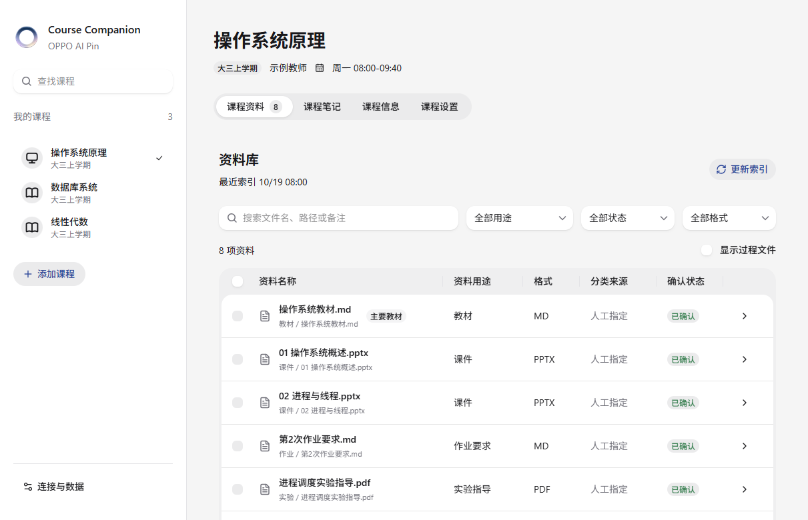
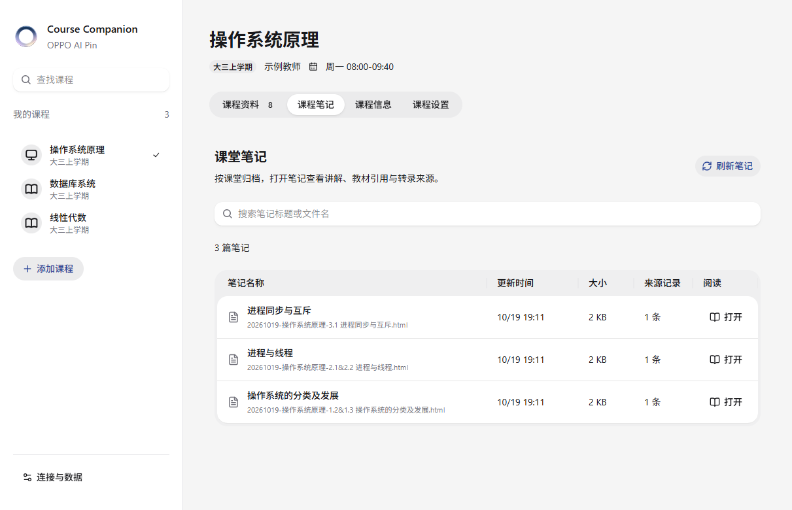
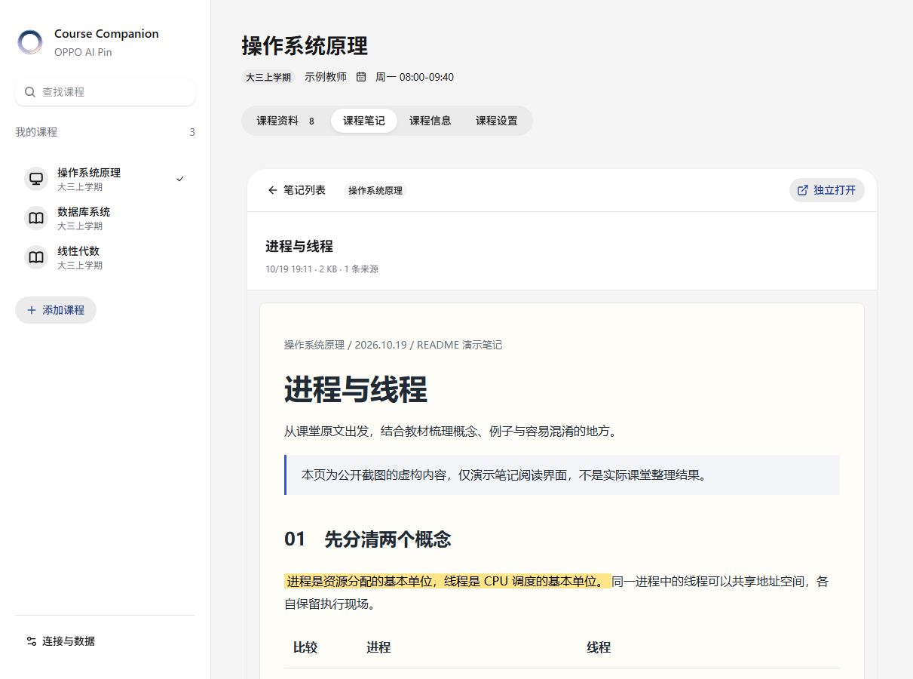
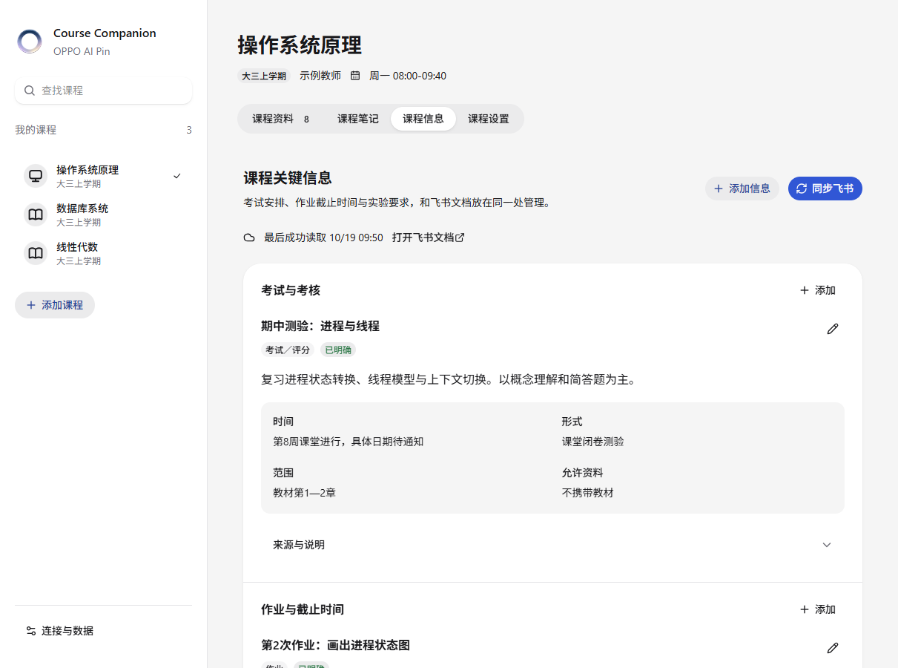
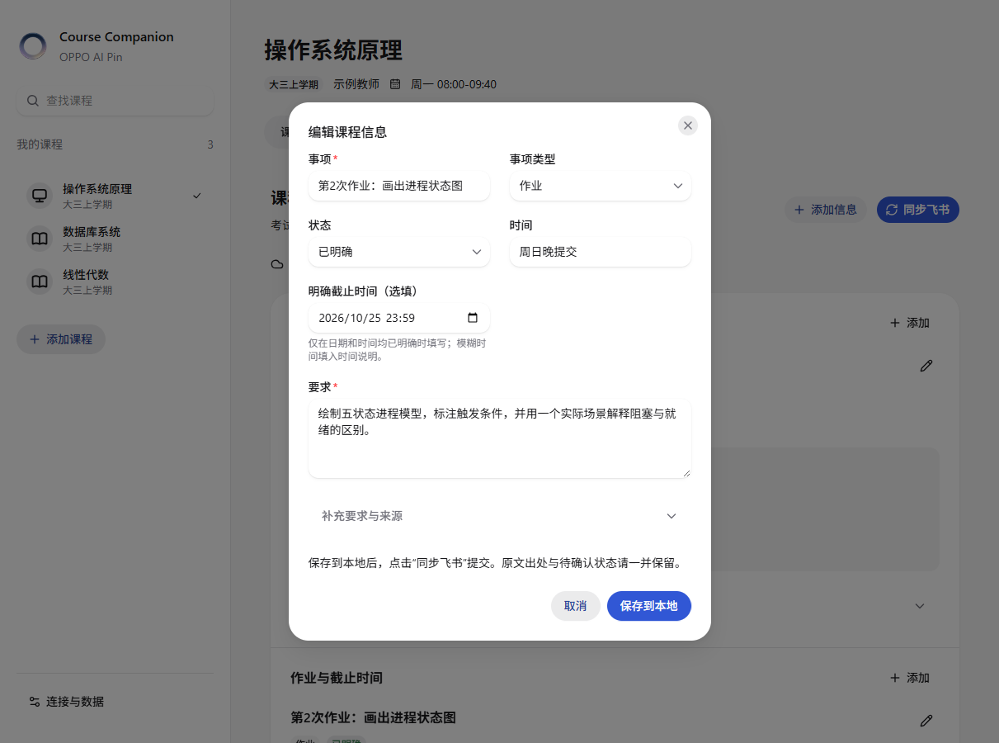

<h1><picture>
  <source media="(prefers-color-scheme: dark)" srcset="assets/readme/hero-dark.svg">
  
</picture></h1>

**让课堂记录、教材课件、复习笔记和教学通知，回到同一门课程里。**

面向大学生的 Codex 插件。上课佩戴 OPPO AI Pin（心力球），课后先确认课堂记录与课程，再让 Agent 结合本地教材生成有出处的 HTML 笔记；考试、作业和实验要求则整理成可编辑、可同步飞书的课程事项。

<p>Local MCP + 3 Skills · HeroUI React · Python 3.10+ · 非 OPPO 官方插件</p>

[看界面](#showcase) · [开始使用](#start) · [课程资料](#materials) · [课堂笔记](#notes) · [课程事项](#info) · [常见问题](#faq)

<a id="showcase"></a>
<h2><picture>
  <source media="(prefers-color-scheme: dark)" srcset="assets/readme/section-overview-dark.svg">
  
</picture></h2>



> 下方截图均来自真实运行的课程管理界面，使用独立的虚构演示数据；课程、教师、通知、来源记录和笔记正文不代表真实教学安排。演示笔记用于展示阅读界面，并非某次真实录音的生成结果。

| 你要做的事 | 页面入口 | 能得到什么 |
|---|---|---|
| 整理一门课的文件 | 课程资料 | 可搜索、筛选、确认分类的资料库 |
| 回看这节课讲了什么 | 课程笔记 | HTML 笔记列表、课程内预览与独立阅读 |
| 查作业和考试要求 | 课程信息 | 结构化事项、原话来源、飞书同步与冲突处理 |
| 登记课程和资料位置 | 课程设置 | 名称、别名、学期、教师、课表、目录与备注 |

三个 Skills 共用一份集中课程台账。任一课程技能都会返回可点击的课程入口，无需反复向 Agent 描述“这门课的资料在哪”。

<details>
<summary>OPPO AI Pin 产品图</summary>

<p align="center"></p>

产品照片由用户提供，白底版本经 AI 编辑背景；产品品牌及照片的第三方权利不属于本仓库代码许可。

</details>

<a id="start"></a>
<h2><picture>
  <source media="(prefers-color-scheme: dark)" srcset="assets/readme/section-start-dark.svg">
  
</picture></h2>

###  先确认需要哪些东西

| 依赖 | 什么时候需要 |
|---|---|
| 支持本地插件、MCP 和子 Agent 的 Codex 环境 | 运行插件与课程工作流 |
| Python 3.10+ | 启动本地课程管理、存储和 MCP；运行时使用标准库 |
| 你自己的 OPPO AI Pin MCP 连接 | 读取全时记、随口记及接口提供的转录原文 |
| 飞书官方 CLI、授权及配套 Skills | 创建课程信息文档、读取及双向同步 |
| HTML / 插画技能 | 可选，可替换；没有时自动降级为 Agent 自主生成 |

**直接使用已构建的界面不需要安装前端开发依赖。** 若按飞书官方 npm 方式安装 CLI，仍需要 Node.js / npm；它与本插件前端构建是两回事。

###  安装本地插件

```bash
git clone https://github.com/ZiChen-Whisper/oppo-ai-pin-course-companion.git
cd oppo-ai-pin-course-companion
python scripts/package_plugin.py
```

仓库根目录就是插件源目录；打包命令生成 `dist/oppo-ai-pin-campus.zip`。通过当前 Codex 宿主支持的本地插件或 ZIP 导入入口安装，重新加载插件。不同宿主的安装入口可能不同，仓库不假定每个版本都有相同按钮。

也可以把克隆后的**完整目录路径**发给 Codex：

```text
请把这个目录中的 OPPO AI Pin Course Companion 安装为本地插件，
使用它现有的 plugin.json 和本地 MCP 配置，不带入作者的个人连接。
```

插件显示名是 **OPPO AI Pin Course Companion**，内部插件标识为 `oppo-ai-pin-campus`。安装后应能找到三个课程 Skills 与本地课程 MCP。公开包不含作者的远程 MCP 地址或登录信息，你需要单独连接自己的 OPPO AI Pin 服务。

###  第一次登记课程

在聊天中调用：

```text
使用 $oppo-ai-pin-campus:oppo-ai-pin-course-manager 管理我的课程。
```

第一次使用时，Agent 才会询问课程资料位置。你可以先添加一门课，填写课程名和主目录，再补充：

- 别名：帮助把录音中的简称对应到正式课程名。
- 教师与学期：便于识别、浏览课程。
- 上课星期与起止时间：辅助判断多段录音是否属于同一节课。
- 额外目录：关联不在课程主目录下的资料。
- 指定教材、课件、实验指导及备注：告诉 Agent 哪些资料优先使用。

保存课程后，在聊天中要求“为这门课建立资料索引”。之后就能从资料页查看文件、核对用途、指定主要教材。

###  连接 OPPO AI Pin 和飞书

OPPO AI Pin 连接需要能够调用 `recall_memory` 与 `recall_note`，并取得当前服务实际提供的转录字段。服务入口、可用权限与授权方式，以你使用的产品环境为准；本仓库不提供共享账号或私人网关。

飞书仅用于课程事项流程。先按[飞书官方 CLI 安装与使用指南](https://www.feishu.cn/content/article/7623291503305083853)或[官方仓库的安装与快速开始](https://github.com/larksuite/cli/blob/main/README.zh.md#安装与快速开始)完成安装、应用配置、用户登录及文档权限授权，再安装官方配套的 `lark-doc`、`lark-shared` 等 Skills。

首次调用课程事项技能时，可以让 Agent 创建文档，也可以关联已有文档：

```text
使用 $oppo-ai-pin-campus:oppo-ai-pin-course-info，
为我的课程创建一个飞书课程信息文档并关联到插件。
```

没有配置飞书时，课程资料管理和本地笔记仍可使用；课程事项页的云端读取与写回需要完成飞书配置。不要把“页面已保存”理解为“飞书已同步”。

<a id="materials"></a>
<h2><picture>
  <source media="(prefers-color-scheme: dark)" srcset="assets/readme/section-materials-dark.svg">
  
</picture></h2>

###  资料用途与格式分开管理

同一个 PDF 可能是教材，也可能是实验指导书。插件把“它是什么格式”和“它用来做什么”分开保存。

支持的用途包括：**教材、课件、参考阅读、作业要求、作业成果、实验指导、实验报告、复习资料、课堂笔记、代码 / 数据、其他资料、待分类**。

资料页可以：

- 按文件名、路径和备注搜索，按用途、格式及确认状态筛选。
- 在表格中浏览文件，使用分页控制展示数量。
- 打开资料详情，查看分类依据并修改用途、备注。
- 多选资料，批量确认分类；将一份资料设为主要教材。
- 查看默认隐藏的过程文件，区分“索引总数”和“当前显示数”。

自动分类通常来自文件名、路径及格式规则，界面会标明来源与确认状态。**规则建议不代表模型已经通读文件。** 只有实际阅读分析后的判断才可标为模型建议；你确认的用途、主要教材和备注优先保留。

###  课程设置负责维护基础信息

名称、别名、教师、学期、课表、目录和备注在本地集中维护。图标可从打包的 Gravity UI SVG 图标中自由选择，支持搜索与分页，不与“计算机课”“数学课”等类型绑定。

目录可通过系统目录选择器选择；选择器依赖 Python 的 Tk 支持，不可用时可以粘贴完整路径。所有课程共用中央台账，各课程目录不需要各自维护另一份课程清单。

###  怎样更新索引

```text
我给数据库系统新增了一批课件，更新这门课的资料索引。
```

索引更新固定派发 **`gpt-6-luna / high` 子 Agent**。界面的“更新索引”会保存请求；回到聊天调用课程管理，由宿主派发执行。它不是点击后立即完成扫描的后台按钮。

课堂回顾发现索引从未成功建立，或距上次成功更新时间已达到 **72 小时**，会请求更新。更新失败会保留旧索引并报告原因，不把尝试时间当作成功时间，也不擅自换模型。

<a id="notes"></a>
<h2><picture>
  <source media="(prefers-color-scheme: dark)" srcset="assets/readme/section-notes-dark.svg">
  
</picture></h2>



###  完整走一次课堂回顾

```text
使用 $oppo-ai-pin-campus:oppo-ai-pin-class-review，
看看上次整理之后有哪些新的课堂记录，先让我确认课程和合并方式。
```

1. **同步与筛选。** 后台完整检查全时记、随口记及分页，发现新增记录、迟到转录或内容变化；确认表只列上次成功总结快照之后新增 / 变化的条目，以及已确认但制作未完成的条目。首次从未总结时列全部；旧历史只报数量，需要时再展开回看。
2. **提出课程与合并建议。** 结合已登记课表、课程别名、原文话题与相邻段落，说明建议将哪些录音归为一节课，以及转录实际覆盖到哪里。
3. **由你确认。** 例如“第2、3、4条属于操作系统，合并；第5条不是课程”。没有明确确认，不直接生成某门课的笔记。
4. **阅读原文与教材。** Agent 完整阅读选定转录，按资料索引定位并打开教材、课件及需要的实验指导；索引只负责找位置，不能代替正文阅读。
5. **制作并校验。** 输出有章节、讲解、引用及来源说明的自包含 HTML，检查阅读、目录、引用跳转与手机布局。
6. **导入与登记。** 笔记放入对应课程的课堂笔记目录，验证产物与来源 hash 后完成整批登记，出现在课程笔记列表，并交付课程入口。

**采集完成不等于总结完成。** 只有整批制作成功才推进总结快照；失败或中断时保留确认和批次继续重试，制作期间新到的内容留到下一轮。

旧版没有完整总结快照时，会明确提示按历史完成时间兼容筛选及其限制；之后成功完成一批便使用快照筛选。你始终可以要求回看历史，不会删除未选的旧记录。

###  为什么不能只看设备摘要

如果你 11:50 下课，设备的一段摘要却在 11:33 结束，插件不会直接把 11:33 当作课堂终点。Agent 会继续检查相邻分段、会话及逐句转录，结合课表判断是否续讲。

- 后面有相关原文：建议合并，并说明采纳的时间片段。
- 中间有较长空档：作为待核对间隔，不直接认定丢录。
- 11:33—11:50 完全没有原文：明确缺失，不能补写这段内容。
- 一条会话混入多门课：先确认课程及片段范围，不能把整段都归入一门课。

**笔记主要依据转录原文，MCP 自动摘要只作参考。** 摘要与原文冲突时以原文为准；没有原文时注明“仅摘要，待原文核实”，不能冒充教师逐字原话。时间窗也只是辅助线索，不会把调课、提前下课或课间停顿硬套进课表。

###  笔记里有什么，怎样阅读



笔记按当堂内容组织概念前提、课堂例子、教材补充、易混点、必要公式或步骤。课堂讲授与教材补充会区分；关键依据附必要原文、文件、章节编号及页码 / 幻灯片页，并在文内提供引用跳转。

在“课程笔记”页面搜索标题或文件名，点击“打开”进入课程内阅读区；也可独立打开。返回列表会保留搜索条件和当前会话中的列宽调整。表格列宽可拖动调整，也支持键盘操作。

HTML 应自包含，可作为本地文件离线阅读。界面中的预览采用隔离页面，仅加载内嵌资源；依赖外部网络资源或宿主权限的 HTML 可能无法正常预览。

命名使用**课堂发生日**，优先沿用真实教材章节编号：

```text
20261019-操作系统原理-2.1&2.2 进程与线程.html
```

多章节编号用 `&` 连接，后面写概括主题；找不到可靠章节编号时直接用课堂主题，不编造。长文件名会缩短主题，完整标题与来源留在正文；同名文件保留版本后缀，避免覆盖。

<a id="info"></a>
<h2><picture>
  <source media="(prefers-color-scheme: dark)" srcset="assets/readme/section-info-dark.svg">
  
</picture></h2>



###  从历史记录中提取教学通知

```text
使用 $oppo-ai-pin-campus:oppo-ai-pin-course-info，
检查所有历史记录，整理考试、作业和实验要求，并同步课程信息。
```

课程事项流程会复查全部历史记录与飞书已有事项，覆盖考试时间、地点、形式、范围、作业与 DDL、实验和报告、分组及评分等内容。**这与课堂笔记的增量确认表不同**：事项需要检查旧通知是否有更新或延期。

同一事项多次提及会补充来源；延期、调整范围保留关联变更。课程归属不清会先询问；同学转述和口头举例保留相应状态，不能自动升级成正式通知。

###  固定字段，保留未知与原话

| 字段组 | 内容 |
|---|---|
| 基本信息 | 事项名称、类型、状态、具体要求 |
| 时间 | 原始时间说明；日期和时刻均明确时才填写截止时间 |
| 条件 | 地点、形式、范围、提交方式、分组、评分、允许资料 |
| 证据 | 原话、来源记录及时间、限制与待确认、保留的旧原始记录 |

类型包括考试 / 评分、作业、实验 / 报告、教学通知、变更 / 备注及其他。状态包括待确认、转述待确认、已明确、已变更 / 被替代和用户确认完成。**DDL 过去不会自动标记为完成。**

“来源与说明”默认折叠，主界面先展示要求、状态和日期。旧段落兼容解析成字段展示，未知字段、原始记录及人工备注保留；读取时不会自动重写飞书。字段定义见[课程事项字段 v1](references/course-info-fields.md)。

###  在页面编辑，再同步到飞书



页面的“课程信息”与飞书文档对应课程章节使用同一套事项内容。点击编辑后，类型 / 状态用选择器，明确截止时间用日期时间控件，原话与来源单独维护。

1. 点击“保存到本地”：保留本机编辑并标为待上传。
2. 点击“同步飞书”：先读完整云端内容，再提交**当前课程**的待上传修改。
3. 两端同时改了同一项：保留两份内容，选择采用飞书版本或保留本地修改。
4. 写入后回读核实：只有核实成功才报告同步成功；中断重试保留去重信息。

带批注、链接或复杂格式的飞书段落继续在飞书编辑，避免破坏原结构。页面不是实时协同编辑器，不会自动推送每次输入；未同步的本地修改也不会被普通刷新静默丢掉。

飞书使用课程名称作为归属标题，下面分类维护事项。教师、学期、课表和目录只放在本地课程设置，不再在云文档重复维护课程概览。

<a id="customize"></a>
<h2><picture>
  <source media="(prefers-color-scheme: dark)" srcset="assets/readme/section-customize-dark.svg">
  
</picture></h2>

###  使用默认技能、自己的技能，或自主生成

`whisper-html` 和 `whisper-illustration` 都是**可选依赖**，不随本仓库打包。可以直接指定自己的笔记样式：

```text
这次笔记使用我的 my-course-notes 技能，不需要插画；
保留课堂原文、教材引用和来源跳转。
```

| 环境 | 处理方式 |
|---|---|
| 你指定的技能已安装 | 读取并使用你的技能 |
| 默认两个技能都可用 | 使用 whisper-html 文档型模板和插画流程 |
| 没有 HTML 技能 | Agent 自主编写有目录、引用及移动端布局的离线 HTML |
| 缺少插画技能或生图能力 | 省略装饰插画，必要的概念关系可用原创 SVG / HTML 图解 |
| 模板强制依赖无法满足 | 整体降级为自主生成，说明实际方式 |

风格可换，课程确认、原文核对、文件命名、引用和产物登记规则仍保留。插件不会为了缺少美化技能而阻塞课程整理，也不会宣称调用了不存在的技能。

<a id="faq"></a>
<h2><picture>
  <source media="(prefers-color-scheme: dark)" srcset="assets/readme/section-privacy-dark.svg">
  
</picture></h2>

###  数据保存在哪里

中央数据默认位于 `%LOCALAPPDATA%/OPPO-AI-Pin-Campus`；无 `LOCALAPPDATA` 的环境回退到 `~/Documents/OPPO-AI-Pin-Campus`。可用 `OPPO_AI_PIN_DATA` 指定独立目录。

Windows 应用宿主可能使用应用私有的 `LOCALAPPDATA`，与终端不同。**以本地 MCP 返回的 `data_root` 为准**，运行 CLI 时显式传入，避免误建第二套台账。

```text
<data_root>/
├── registry.json                 # 全部课程、目录、人工分类与飞书关联
├── indexes/                      # 各课程资料索引
├── records.json                  # 采集记录、归属、产物与总结快照
├── review-batches/               # 笔记制作批次与来源快照
├── jobs/                         # 索引更新请求和状态
├── course-info.json              # 课程事项镜像、待上传编辑和冲突
├── course-info-remote.json       # 最近完整读取的云端快照
└── course-info-history/          # 切换文档关联时保留的旧镜像

<课程资料目录>/OPPO-AI-Pin/
├── 元数据/                      # 所选原始记录、来源清单及制作源码
└── 课堂笔记/                    # 已生成的自包含 HTML
```

本地保存不等于离线分析：资料和转录会进入你使用的 AI 会话；课程事项流程还会写入你指定的飞书文档。备份课程目录时，也请备份集中数据目录；两者不是互相替代的副本。

###  为什么换账号后找不到插件

源码不绑定作者的 ChatGPT 账号，但**账号 / 工作区插件条目、本机安装与课程数据、外部服务授权**是不同部分。换账号后，可能需要在新账号重新导入本地插件并配置 OPPO AI Pin、飞书连接。

同一 Windows 用户下，本地数据目录不会按 ChatGPT 账号自动隔离；需要隔离时使用不同的 `OPPO_AI_PIN_DATA`。换电脑还要迁移课程资料、集中台账并重新授权外部服务，不能假设账号登录会自动恢复全部本地内容。

###  页面打不开、看不到新笔记怎么办

- **127.0.0.1 拒绝连接：** 本地服务可能已停止。重新调用任一课程技能，或运行 `python runtime/app.py --data-root "<实际目录>" open`，使用新返回的完整 URL；旧地址不是永久书签。
- **笔记没有出现在列表：** 确认 HTML 已放进该课程的 `OPPO-AI-Pin/课堂笔记/`，再点“刷新笔记”。笔记列表读取产物目录，不需要为此重建教材索引。
- **预览空白或资源缺失：** 先确认 HTML 自包含；预览隔离会阻止外部网络资源。不要用依赖临时目录或插件缓存的页面当作最终产物。
- **资料数量不同：** 检查筛选条件、分页和“显示过程文件”。规则分类未确认不代表文件丢失。
- **飞书内容看起来没更新：** 查看最后成功读取时间、待上传标记和冲突提示，再执行同步。认证失败时按官方飞书技能处理。

本机入口的 URL 包含访问凭据，只在本机使用。不要把完整入口、真实转录、个人目录或私人文档链接贴到 Issue、截图或公开 README 中。

###  当前边界

- 无法取得音频源文件，不提供录音播放、下载或按时间点回放。
- 设备没有录到的内容不会补造；自动摘要不替代转录原文。
- 不自动完成作业，不默认创建日历或任务，也不默认给他人发消息。
- 索引模型不可用时报告失败；不会悄悄换成其他模型。
- 界面保存索引请求和课程事项编辑，不等于宿主子 Agent 或云端写入已经完成。
- 公开包不含作者个人 MCP 配置、OAuth 信息、课程资料、转录数据或私人飞书关联。

<a id="development"></a>
<h2><picture>
  <source media="(prefers-color-scheme: dark)" srcset="assets/readme/section-development-dark.svg">
  
</picture></h2>

###  代码结构与本地运行

```text
runtime/       Python 本地 MCP、课程台账、采集与批次、笔记预览、飞书同步
skills/        课程管理 / 课堂回顾 / 课程事项三个工作流
references/    共用流程、索引约束、事项字段定义
frontend/      React 19 + HeroUI 3 界面源代码
ui/            已构建的界面，安装使用时直接提供
assets/        插件图标、产品图与公开演示截图
scripts/       插件打包等工具
```

前端使用 HeroUI React 3.2.6，以及本地共享包 `@question-bank/ui-pro` 的 Data Grid、Action Bar、Empty State。共享包需要自行提供；本仓库没有复制其源码，克隆仓库后不能假定前端开发依赖已齐全。

```bash
# Python 运行时检查
python -m unittest discover -s tests -v

# 打开本地页面；请使用自己的实际集中数据目录
python runtime/app.py --data-root "<实际目录>" open

# 打包本地插件
python scripts/package_plugin.py
```

需要修改前端时，在 `frontend/` 运行：

```bash
npm ci
npm run link:library -- "<HeroUI共享库目录>"
npm run check
npm run build
```

构建产物写入 `ui/`。运行时与开发依赖分开；只使用插件时无需自行构建 React 界面。

###  验证范围与贡献方式

仓库包含分页、去重、来源变化保护、制作检查点、笔记发现、结构化字段、飞书三方合并及中断重试的测试。同步写回用隔离的模拟云端验证；公开截图使用独立演示数据，不是对所有账号、宿主与飞书租户的兼容性保证。

欢迎通过 [Issues](https://github.com/ZiChen-Whisper/oppo-ai-pin-course-companion/issues) 提交问题或建议。反馈界面问题时，请提供版本、操作步骤和脱敏截图；同步问题可提供错误文字，避免上传凭据或真实课堂原文。

###  许可与素材

代码及原创 README SVG 使用 [MIT License](LICENSE)。HeroUI、图标库及其他依赖遵循各自许可，见 [THIRD-PARTY-NOTICES.txt](THIRD-PARTY-NOTICES.txt)。OPPO 品牌、产品照片和第三方图标的权利不包含在本仓库 MIT 授权中，见 [ASSET-NOTICE.md](ASSET-NOTICE.md)。
